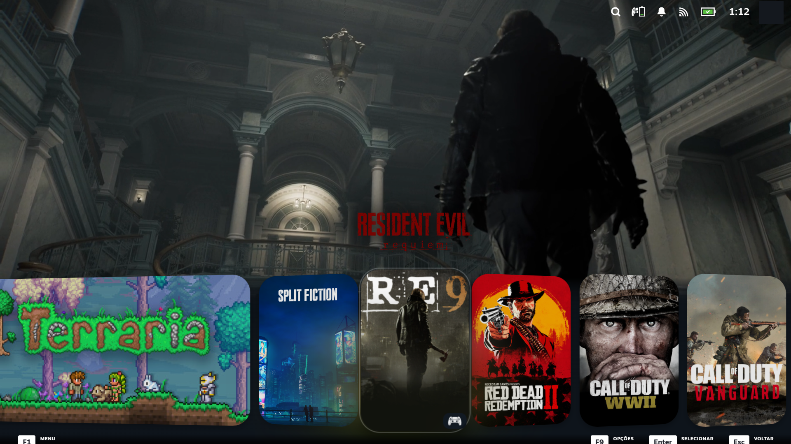
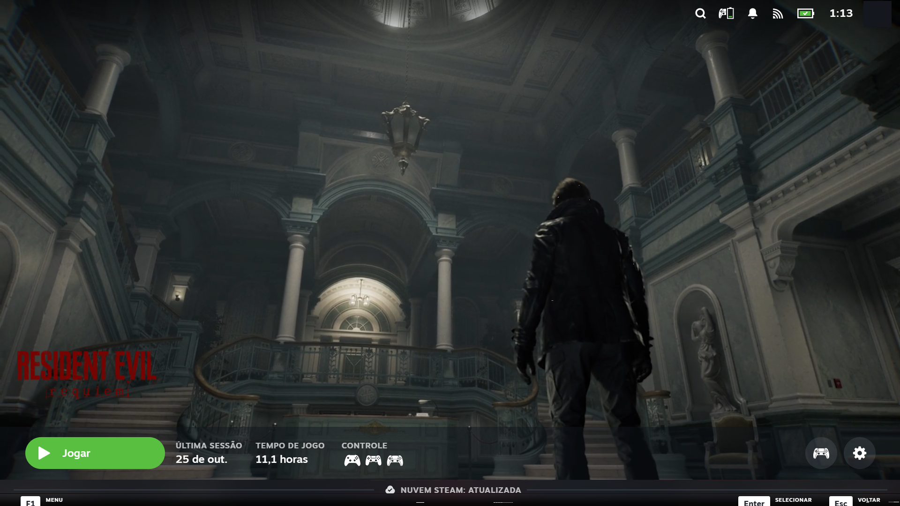

# Trailer Hero

A Decky Loader plugin that plays the game's trailer (muted, looping) in two places of the Steam library (Big Picture):

- **Game page**: replaces the hero image after 4 s (adjustable).
- **Game selection** (Home): plays behind the focused game after 8 s with the **same game** focused (adjustable).
  Changing game resets the countdown and removes the video.
- **Logo instead of name** (Home): the focused game's name is replaced by its logo. If there is no logo, or it fails to
  load, the name stays. On by default.

Panel options for the logo: size, soft black shadow, fine horizontal/vertical offset (px), hide the "last played" text and
pin the logo to the left corner (above the first card). With themes that center the game text (for example CSS Loader's
"Centered game text") the logo centers on the card by itself, unless "Pin to the left corner" is on.

Documentação em português: [README.pt-BR.md](README.pt-BR.md).

## Screenshots




## How it works

1. On `/library/app/<id>`, after a few seconds (default 4 s), the plugin queries the store API
   (`appdetails?filters=movies`) and takes the first trailer's H.264 DASH manifest.
2. The store no longer publishes MP4. The trailer is fMP4 in ~3 s chunks, so the plugin downloads `init + 30 s of chunks`,
   concatenates them into a `Blob` and plays it in a muted `<video>`, without hls.js or MSE.
3. Game page: the `<video>` goes right after `.ImgContainer` (the hero image), over the image and under the title logo.
   Selection: it goes at the end of `.RecentGamesBackgroundImages`, over the images and under the rest of the Home. The
   focused game is the one whose image has class `Visible` and not `OffScreen`.
4. The video is destroyed (not just paused) when the Steam window is hidden or the hero scrolls off screen, and when you
   leave the page. Downloaded clips are cached (4 games).
5. Logo: the appid comes from the tile's cover (`customimages/<id>p.png`). The logo is the first one that loads from the
   addresses Steam itself reports (`appDetailsStore.GetLogoImagesForAppId`), then `steamloopback.host/customimages/<id>_logo.png`,
   `.../assets/<id>/logo.png`, `.../library_logo.png` and the store CDN. Loaded logos are kept in `localStorage`
   (`trailer-hero:logos`: webp up to 200 px tall, 60 games, refreshed after 7 days), so later launches show them without
   waiting for Steam's local server, which is slow right after startup. Logos that exist only on the CDN (no CORS) are not
   stored. The text is hidden (`opacity:0`) and the image is placed above the tile grid, which clips anything above it,
   following the focused tile's text block frame by frame.

Everything runs in the Steam window's context (`SteamUIWindows[0].m_BrowserWindow`), which reaches the store and the CDN
without CORS problems.

## Development

```
npm install
npm test          # pure logic (src/trailers.ts, src/logos.ts)
npm run build     # produces dist/index.js
```

Install: copy `plugin.json`, `main.py`, `package.json` and `dist/index.js` to `homebrew/plugins/TrailerHero/`.
To update, copy `dist` and restart Steam (reloading the plugin also works, but avoid back-to-back reloads).

**Known Steam hang:** hiding and showing the Big Picture window with a `<video>` alive froze Steam's main `steamwebhelper`
process in tests. The plugin therefore removes the video as soon as `visibilityState` stops being `visible`. With that fix,
a 30 s hide with a trailer playing did not hang (one run). Hiding the window without the plugin was not tested, so it is
unknown whether the plugin is a necessary condition.

Diagnostics in `SharedJSContext`: `__trailerHero.status` and `__trailerLogos.status`. `__trailerHero.assumeVisible = true`
skips the window visibility check (the video does not play while the window is hidden, but it downloads and positions).

## Limits

- Tested only on Windows with the experimental Decky Loader build; not yet tested on SteamOS.
- Class names such as `.TopCapsule`, `.ImgContainer`, `.Message` and `.RecentGamesContainer` come from Steam's UI and can
  change in an update.
- Games without a store trailer keep the hero image; the plugin retries after 60 s.
